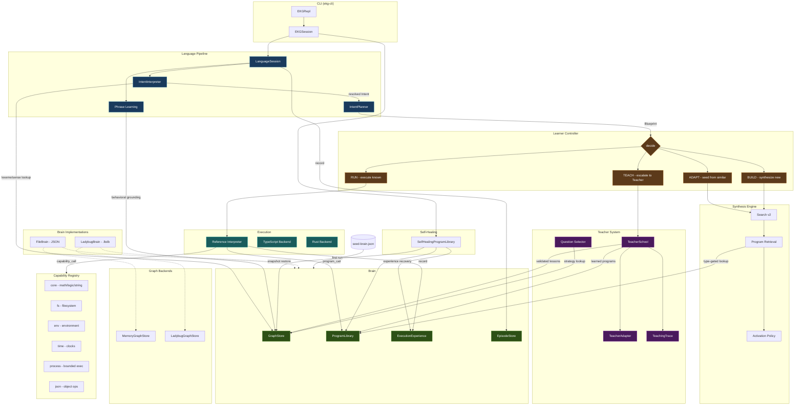

# Executable Knowledge Graph Intelligence (EKG-AI)

EKG-AI is an experiment in **lifelong executable intelligence**: a system whose concepts, language, procedures, capabilities, corrections, tests, and lived episodes accumulate in an inspectable knowledge graph and executable program library.

> **This project is not an LLM.** It is not expected to know the world with zero training. Learning may be bootstrapped; knowledge and understanding are taught and accumulated. The graph and executable library are part of the intelligence itself.

**Status:** not actively developed. The last feature commit was on Aug 20, 2026 (package version 0.9.9). Work continued in [Spoon](https://github.com/KealJones/spoon), which began as a Rust rename of EKG. See [History](#history).

## North star

- **Education, not zero-shot miracles.** EKG is allowed to start ignorant and get taught.
- **Ever-learning.** Useful knowledge is not frozen permanently into model weights.
- **Executable knowledge.** Concepts can ground into typed programs and host capabilities.
- **Makes tools from tools.** Reusable learned compositions become capabilities of the growing system rather than temporary agent-tool calls.
- **Host-adaptive.** Files, paths, process/shell, environment, clocks, and other affordances are explicit host boundaries; EKG should adapt to what a host provides.
- **Semantic portability, not lowest-common-denominator APIs.** A concept may enter the portable core when roughly 80-90% of representative runtimes support the same semantics and outliers have practical adapters (for example Bash + `jq` for recursive JSON/object data). Hosts adapt to EKG's semantic types; one runtime does not define the limits of EKG's ontology.
- **Lived context.** Past lessons, corrections, episodes, programs, semantic relations, and evidence are durable context retrieved from experience rather than repeatedly stuffed into a prompt.
- **Teacher as educator.** Frontier LLM assistance is scaffolding/Teacher supervision whose successful corrections become graph knowledge and future training data.

Read [`docs/PROJECT_GOSPEL.md`](docs/PROJECT_GOSPEL.md) before making architectural tradeoffs.

## Current capabilities

- Language-neutral typed Blueprint IR
- 87 host capabilities: integer, boolean, string, list and JSON primitives (pure), plus path, filesystem, environment, clock, bounded process execution and Bash (effectful)
- Reference interpreter, TypeScript backend, and a Rust source emitter (`src/backends/`)
- Graph-native concepts, capabilities, teaching traces, and evidence
- Typed synthesis (Search v2) and learned-program reuse
- A graph-backed semantic parser, with typo correction, `then` chaining, and corrections ("wrong", "nope" re-evaluate the last turn)
- A Teacher (Claude or ChatGPT CLI) that returns structured lessons: groundings, capability mappings, Blueprints, facts, synonyms and grammar constructions
- **LadybugDB** embedded graph backend with OpenCypher queries (falls back to an in-memory graph saved as JSON)
- **Seed brain** with a pre-installed English vocabulary drawn from WordNet
- **EKGBench**: all 20 bAbI prerequisite families plus personal aspirational milestones

## Development model

Red benchmarks are not bugs - they are the curriculum.

```
red milestone -> teaching/experience -> durable competence -> later composition
```

A Teacher lesson supplies a validated Blueprint composed from existing capabilities. After validation, that procedure is acquired as a durable learned capability. The same locked milestone then passes without adding task-specific host primitives. Unsolved milestones remain red until prerequisite concepts are taught.

The curriculum is chosen for **general reuse**, not benchmark convenience. A red task tells us which prerequisite concept is missing; we teach that concept and let benchmark improvement be a consequence.

## Architecture



### How it fits together

**Language pipeline:** Raw utterance hits the `IntentInterpreter`, which resolves lexemes/senses through the knowledge graph. Resolved intents go to the `IntentPlanner`, which compiles semantic relations into portable Blueprint IR.

**Learner controller:** Blueprints enter the `RUN -> ADAPT -> BUILD -> TEACH` decision loop. Known programs execute immediately (RUN). Similar programs seed synthesis (ADAPT). Fresh synthesis explores type-guided search (BUILD). Unknown language or capabilities escalate to Teacher (TEACH).

**Brain:** Four durable stores behind the `Brain` interface - graph (concepts, language, world facts), program library (learned Blueprints), execution experience (call traces), and episodes (task decisions). Two backends: `LadybugBrain` (embedded Kuzu with OpenCypher) and `FileBrain` (JSON fallback).

**Self-healing:** `SelfHealingProgramLibrary` wraps the program library. Recovery chain: live lookup -> graph snapshot restore -> experience-based reconstruction from historical usages. Teacher escalation is last resort.

**Teacher:** `TeacherSchool` validates and commits structured lessons - lexical curriculum, synonyms, executable programs. Successful lessons become durable graph knowledge and learned capabilities. Teaching traces record the full observation/impasse/hypothesis/experiment chain.

### Context-sensitive language

A lexical form is not its meaning. EKG keeps explicit senses and may learn contextual evidence that selects among them without erasing alternatives. See [`docs/CONTEXTUAL_LANGUAGE.md`](docs/CONTEXTUAL_LANGUAGE.md).

## Getting started

### Prerequisites

- Node.js 18+
- pnpm
- Optional: the `claude` or `chatgpt` CLI, for the Teacher

### Install and run

```bash
git clone https://github.com/kealjones/ekg-ai.git
cd ekg-ai
pnpm install
pnpm run ekg
```

`pnpm run ekg` runs the CLI straight from TypeScript with `tsx`; no build step is needed. On first run, EKG loads the **seed brain** (`ekg-data/seed-brain.json`), so it understands basic requests with no training step. The seed holds about 4,600 graph entities, including:

| What | Count |
|------|-------|
| Lexemes (mostly from WordNet) | 1,105 |
| Word senses | 1,377 |
| Concepts | 1,803 |
| Host capabilities | 87 |
| Grammar constructions | 43 |
| Grammar rules (legacy template system) | 28 |
| Inference rules | 9 |
| World facts | 131 |

The seed ships with no learned programs; those accumulate in your own brain as you use it.

CLI flags: `--brain PATH`, `--backend memory|ladybug|auto`, `--teacher on|off`, `--once "UTTERANCE" --inputs '[...]'` (answer one request and exit), and `--no-banner`.

### Talk to it

Type a request and EKG works out what you mean, builds an executable program, and runs it.

```text
EKG> multiply this number by six
input[0] (int)> 7
42

EKG> deduct six from this number :: [20]
14

EKG> what is 7 times 8
56

EKG> multiply seven by three
21
```

The `:: [values]` syntax supplies inputs inline instead of being prompted for them. Numbers written in the sentence ("seven", "8") are picked up without it.

### Chain operations with "then"

Use the word `then` to compose multi-step operations. Each step feeds its result into the next.

```text
EKG> multiply this number by three then add five :: [4]
17
```

### Teach it new words

If EKG doesn't know a word, it says so (or asks the Teacher, if one is configured). You can teach a synonym for a word it already knows. The known side must be a single word EKG already has, such as `subtract` or `multiply`.

```text
EKG> minus six from this number :: [20]
Could not resolve: no grounded action phrase

EKG> /teach synonym minus = subtract
Learned: minus -> Subtract (via subtract)

EKG> minus six from this number :: [20]
14
```

Taught vocabulary is permanent: it survives restarts and takes part in future composition. Multi-word definitions such as `triple = multiply by three` are not accepted by `/teach synonym`; that kind of lesson comes from the Teacher, which can return whole Blueprints.

### The Teacher

When EKG cannot handle an utterance, it can escalate to a frontier model through its CLI. Pick the provider with `EKG_TEACHER=claude|chatgpt|auto` (default `auto`: whichever CLI is installed). The Teacher returns structured JSON: an answer to show you, plus groundings, capability mappings, Blueprints, facts, synonyms and grammar constructions. Each lesson is validated before it is committed to the graph, and EKG retries the utterance after learning. The metric that matters is that Teacher calls per new task go down as knowledge accumulates.

Say "wrong", "nope" or "try again" after an answer and EKG re-evaluates the last turn.

### Explore its brain

```text
EKG> /help                         List commands
EKG> /brain                        Show brain stats (entities, programs, backend)
EKG> /capabilities                 List all host capabilities EKG can use
EKG> /capabilities fs              Filter capabilities (e.g. filesystem only)
EKG> /programs                     List learned procedures
EKG> /experience                   Show recent execution traces
EKG> /run <program-id> :: [args]   Execute a specific learned procedure
EKG> /teach synonym NEW = KNOWN    Teach a synonym for a known word
EKG> /teacher on|off|status        Control Teacher escalation display
EKG> /export-seed                  Export current brain as a shareable seed file
EKG> /save                         Force-save brain to disk
EKG> /exit                         Save and quit
```

### What it understands

The capability registry covers these domains:

| Domain | Examples |
|--------|----------|
| **Math** | add, subtract, multiply, divide, modulo, negate, absolute value |
| **Comparison** | equals, less than, greater than, at most, at least |
| **Logic** | and, or, not |
| **Strings** | length, concatenate, contains, starts with, ends with, lowercase, uppercase, trim, split, replace |
| **Lists** | length, sum, min, max, reverse, contains, head, tail |
| **JSON** | parse, stringify, get, has, keys, values, type |
| **Filesystem** | list files, read file, write file, file exists, basename, dirname, extension, current directory |
| **Process** | bounded process execution, Bash |

An honest note on the current CLI: arithmetic requests in plain English work reliably. Many string and filesystem requests ("what is the length of this text :: [\"hello world\"]") currently resolve to an integer plan and fail with a type mismatch, even though the capabilities exist and are exercised by the test suite and benchmarks.

### How learning works

When a request runs successfully, EKG persists the synthesized program as a **durable learned capability** in its knowledge graph (`/programs` lists them). The next time you say the same thing, it runs the existing program directly, with no search or synthesis. Related requests can adapt from existing programs instead of building from scratch (`RUN -> ADAPT -> BUILD -> TEACH`).

### Graph backend options

By default (`auto`), EKG uses LadybugDB if the optional `@ladybugdb/core` native module is installed, and otherwise an in-memory graph saved as JSON. When you run without `--brain`, an existing `ekg-data/brain.json` is migrated to `ekg-data/brain.lbdb` automatically.

```bash
pnpm run ekg -- --backend ladybug    # force LadybugDB (needs @ladybugdb/core)
pnpm run ekg -- --backend memory     # force the JSON file
pnpm run ekg -- --backend auto       # default
```

### Run the benchmarks

```bash
pnpm run benchmark:ekg             # developmental report card (bAbI + object milestones)
pnpm run benchmark:search-v2       # synthesis engine speed comparison
```

EKGBench is a developmental curriculum, not a pass/fail exam. Red benchmarks tell you which concepts haven't been taught yet. As of the last commit (rerun Nov 5, 2026) it reports:

- **bAbI families: 13/20 passing**, 6 abstained (coreference, compound coreference, time reasoning, induction, path finding, motivations), 1 wrong (indefinite knowledge answers "no" instead of "maybe").
- **Object milestones: 1/3** (single property access passes; dotted nested paths and variable-depth paths are still red).

`package.json` also has scripts for every earlier experiment (`benchmark:falsification-pilot`, `benchmark:teacher-displacement`, `benchmark:babi-school`, `benchmark:resilience` and more), each tied to an entry in `docs/PROGRESS.md`.

## Development

```bash
pnpm test                          # build, then the fast suite: 194 tests in 30 files, all passing
pnpm run test:experiments          # the v0.4 and v0.5 phase-0 experiment tests, kept out of the fast suite
pnpm run benchmark:ekg             # developmental report card
pnpm run benchmark:search-v2       # synthesis engine benchmark
pnpm run test:ladybug              # LadybugDB mock tests
pnpm run test:ladybug:integration  # real native round-trip (needs @ladybugdb/core)
```

## History

EKG AI is the first of five related prototypes, each built from what the last one taught:

1. **EKG AI** (this repo): a program-synthesis learner you teach like a student.
2. [**Spoon**](https://github.com/KealJones/spoon) (Aug 22 to Sep 9, 2026): began as a Rust rename of EKG, then rebuilt around three LLM seats (ears, mouth, Teacher) and, finally, a single Concept representation.
3. [**Soup**](https://github.com/KealJones/soup) (Sep 10 to 15): concepts as Python-style calls, with a small local model doing only the listening.
4. [**Napkin**](https://github.com/KealJones/napkin) (Sep 16 to Oct 17): everything is a Concept, nothing is privileged, and no model hears or speaks.
5. [**Noodle**](https://github.com/KealJones/noodle) (Sep 29 to Oct 4): a scored chart parser over N-Con that learns how to run commands, with offers and trust levels.

EKG's own history runs from v0.0.1 to v0.9.8 in `CHANGELOG.md` and `docs/PROGRESS.md`. Most of it predates the GitHub repo, which was uploaded on Aug 15, 2026; feature work on GitHub ran from Aug 15 to Aug 20. The milestones:

| Version | Milestone |
|---------|-----------|
| v0.0.1 | Portable execution spike: typed Blueprint IR, reference interpreter, tiny typed synthesis |
| v0.0.2 | Impasse controller: the `RUN -> ADAPT -> BUILD -> TEACH` loop |
| v0.0.4 to v0.0.10 | Learned programs as building blocks, promotion gates, retrieval and activation |
| v0.0.11 to v0.0.13 | Teacher Mode as research data, and the first real conversational Teacher episode |
| v0.0.14 | Intent Interpreter inspired by Viv Labs' Concept Action Network (`docs/ADR-002-viv-inspired-intent.md`) |
| v0.1.0 | First real-world Teacher-displacement milestone |
| v0.2.0 | Falsification pilot: 13/13 held-out tasks with the Teacher off, against 2/13 for an exact cache and 8/13 for nearest neighbour |
| v0.3.x | Primitive-holdout protocol, preregistered after a hostile review |
| v0.7.0 to v0.7.2 | Education milestone, semantic language graph, Teacher School and durable competence |
| v0.8.0 to v0.8.3 | EKGBench school, self-healing learned capability chains, lived-experience recovery |
| v0.9.5 | Persistent local brain that survives restarts |
| v0.9.6 | EKG CLI |
| v0.9.7 | LadybugDB durable graph backend and the seed brain |
| v0.9.8 | The CLI learns from use; bAbI connected to EKGBench; WordNet vocabulary |
| 0.9.9 (Aug 20) | Teacher learning loop (learn, retry, answer), Teacher-taught grammar, correction detection |

Language stayed EKG's weak spot: its parser (graph-backed WordNet senses, a construction grammar and fuzzy matching; an earlier parser built on the `compromise` NLP library is still in `src/intent/smart-parser.ts` but is not on the CLI path) was scaffolding the docs always meant to replace. Two days after the last feature commit, the code was renamed into Spoon and development moved there. The Nov 1, 2026 commit only changed setup docs.

## Further reading

- [`docs/PROJECT_GOSPEL.md`](docs/PROJECT_GOSPEL.md) - product/research doctrine
- [`docs/PROGRESS.md`](docs/PROGRESS.md) - detailed research log with evidence
- [`CHANGELOG.md`](CHANGELOG.md) - version history
- [`docs/LADYBUGDB.md`](docs/LADYBUGDB.md) - graph backend details
- [`docs/CONTEXTUAL_LANGUAGE.md`](docs/CONTEXTUAL_LANGUAGE.md) - context-sensitive language design
- [`docs/ADR-001-core-invariants.md`](docs/ADR-001-core-invariants.md) - architectural decisions
- [`docs/PREREGISTRATION_V0.3.md`](docs/PREREGISTRATION_V0.3.md) - v0.3 experiment protocol
